# Amazon Quick 側の設定ガイド

AWS Workshop「AI-Powered Conversations with your Data Using Amazon Quick and Snowflake via MCP」6章・7章の日本語版です。
ハンズオンで詰まりやすい点（トライアルアカウント、リージョン、Flow のプロンプト）を修正・補足しています。

> 💡 画面は日本語 UI のものです。英語 UI の場合は括弧内の英語表記を目印にしてください。

**前提**：`notebooks/05_mcp_and_oauth.ipynb` を最後まで実行し、Step 5 の値（6項目）を表示できること。

| 05 の Step 5 で表示される値 | 使う場所 |
|---|---|
| MCP server endpoint | 手順 3-4（接続） |
| Client ID / Client secret | 手順 3-5（認証） |
| Token URL / Authorization URL | 手順 3-5（認証） |
| Redirect URL | Quick 側に表示される値と一致するか確認するだけ |

---

## 0. 始める前に（重要）

| 確認すること | 理由 |
|---|---|
| **AWS コンソールのリージョンが US West (Oregon) `us-west-2` または US East (N. Virginia) `us-east-1`** | Snowflake の OAuth 連携には両リージョンのコールバック URL（`https://us-west-2.quicksight.aws.amazon.com/sn/oauthcallback` / `https://us-east-1.quicksight.aws.amazon.com/sn/oauthcallback`）を登録しています。それ以外のリージョンで Quick を作るとログイン後にリダイレクトエラーになります（その場合は 05 の `QUICK_REGIONS` にリージョンを追加して OAuth 連携を作り直してください）。 |
| **Snowflake のユーザー名とパスワードを手元に用意** | Quick から Snowflake にログインするときに使います（トライアルにサインアップしたユーザー）。 |
| **05 の Step 3 を実行済み（DEFAULT_ROLE = `CORTEX_QUICK_HOL_ROLE`）** | DEFAULT_ROLE が ACCOUNTADMIN のままだと、OAuth ログインが拒否されます。 |
| **Client secret はコピー直前に表示** | 05 の Step 5 で `SHOW_SECRET = True` にして実行し、貼り付けたら `False` に戻します。画面共有に注意してください。 |

---

## 1. Amazon Quick を開く

1. AWS マネジメントコンソールにサインインします（ハンズオンでは配布された AWS アカウントを使います）。
2. 画面上部の検索バーに **Amazon Quick** と入力し、検索結果の **Amazon Quick** をクリックします。

   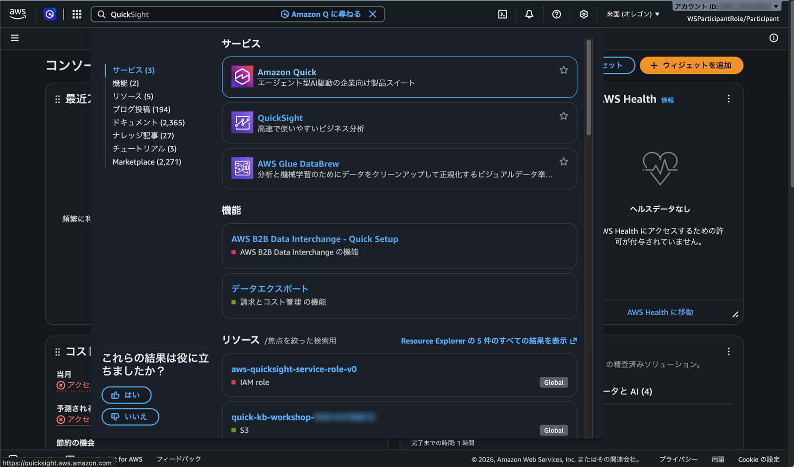

3. アカウント選択画面が出たら、**その他のアクティブな AWS コンソールセッション**（Other active AWS console sessions）の中から、ハンズオン用 AWS アカウントのセッション（例：`WSParticipantRole/Participant`）を選びます。既存の Quick アカウントが表示されても無視してください。

   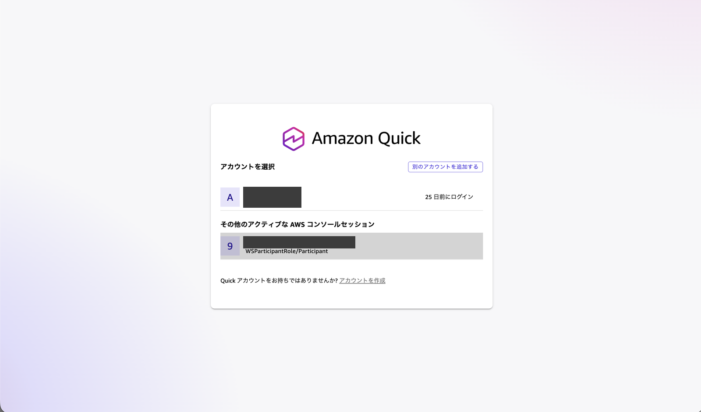

## 2. Amazon Quick にサインアップする（初回のみ）

1. **すぐに始める**（Let's get started）画面で AWS アカウント ID が表示されていることを確認し、**Amazon Quick にサインアップ**をクリックします。

   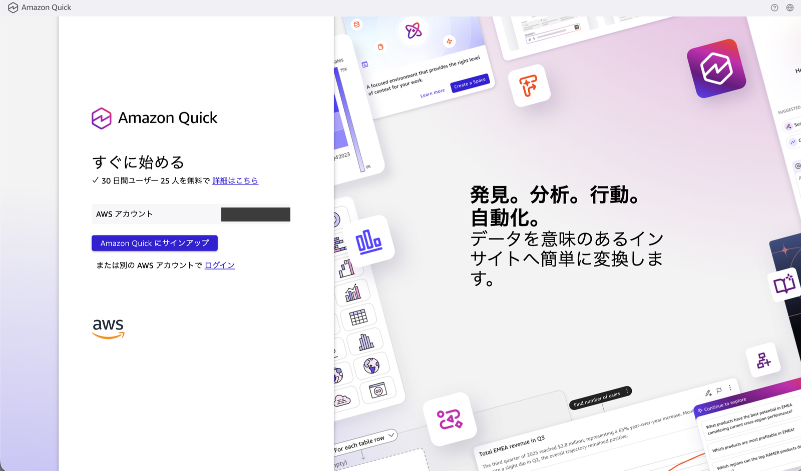

2. 次のように入力します。

   | 項目 | 値 |
   |---|---|
   | アカウント名 | `HOL-LAB`（任意。世界で一意である必要があるため、使われている場合は `HOL-LAB-<名前>` など） |
   | アカウント通知用メールアドレス | 自分のメールアドレス |
   | リージョン | **US West (Oregon)** |
   | 認証方法 | パスワードベースまたはシングルサインオン（推奨） |
   | 暗号化 | Use AWS-managed key (Default) |

   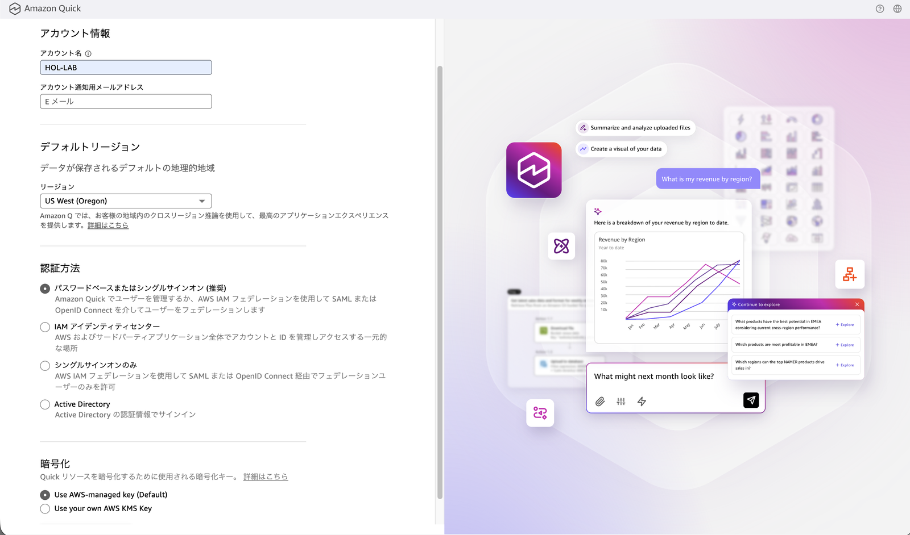

3. **アカウントを作成**をクリックし、「アカウントを作成しています」→「アカウントが正常に作成されました」（緑のチェック）になるまで待ちます。

   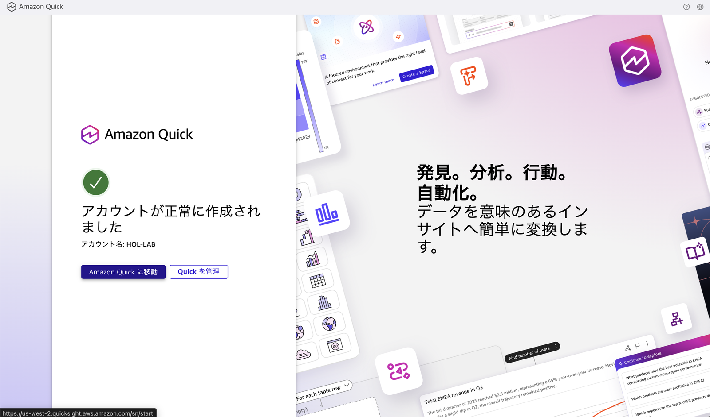

4. **Amazon Quick に移動**をクリックし、アカウント選択画面で再びハンズオン用のセッションを選ぶと、Quick のホーム画面が開きます。

## 3. MCP コネクタを作る

1. 左のナビゲーションの **さらに詳しく** → **コネクタ**（Connectors）をクリックします。

   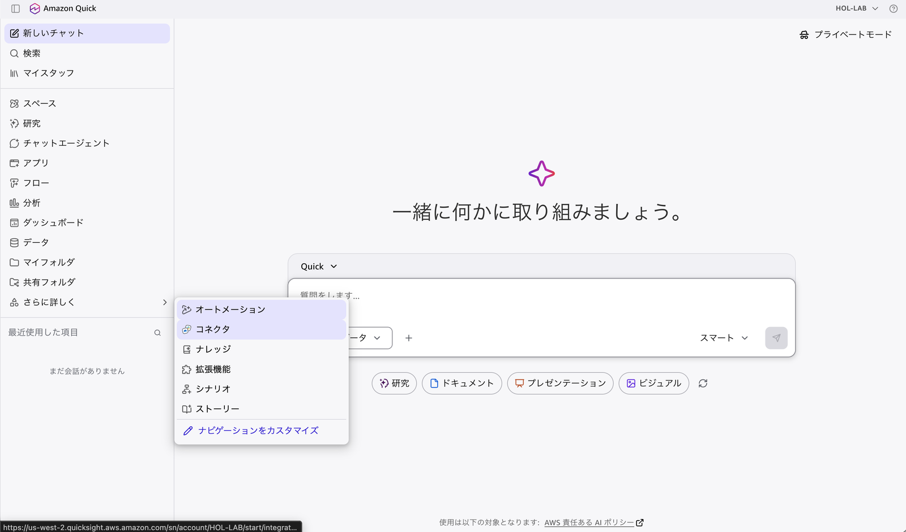

2. **外部アプリケーションを Amazon Quick に接続** の検索欄に `Snowflake` と入力します。
3. **Snowflake Cortex Agent** のタイルをクリックします。

   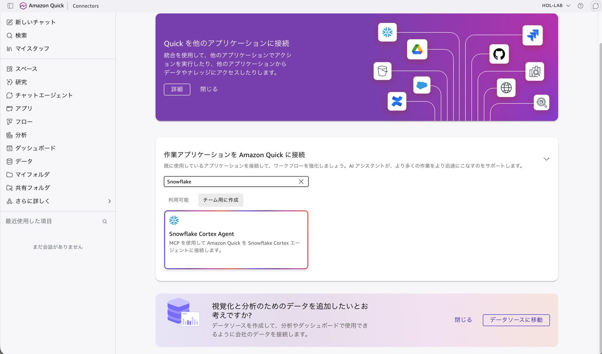

   > 💡 元教材（英語 UI）の「Model Context Protocol」タイルの代わりに、Snowflake 専用のコネクタが用意されています。入力する値は同じです。

4. **接続** ステップで次を入力し、**次へ** をクリックします。

   | 項目 | 値 |
   |---|---|
   | 名前 | `Snowflake-Sales-Ops-MCP` |
   | 説明 | `Snowflake-Sales-Ops-MCP` |
   | MCP サーバーエンドポイント | 05 の **MCP server endpoint**（`https://<組織>-<アカウント>.snowflakecomputing.com/api/v2/...`） |
   | 接続タイプ | パブリックネットワーク |

   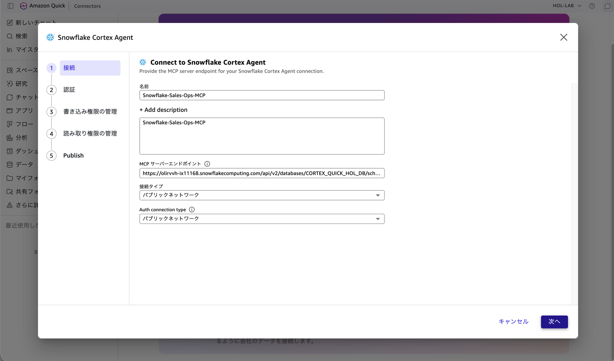

5. **認証** ステップで次を入力し、**作成して続行** をクリックします。

   | 項目 | 値 |
   |---|---|
   | 認証方法 / Auth 設定 | ユーザー認証 / カスタムユーザーベースの OAuth |
   | ベース URL | 自動入力（MCP server endpoint と同じ） |
   | クライアント ID | 05 の **Client ID** |
   | Public OAuth client | チェックしない |
   | クライアントシークレット | 05 の **Client secret**（`SHOW_SECRET = True` で表示した全文） |
   | トークン URL | 05 の **Token URL** |
   | 認証 URL | 05 の **Authorization URL** |
   | リダイレクト URL | 自動入力。05 の **Redirect URL**（us-west-2 / us-east-1 のどちらか）と一致していることを確認 |

   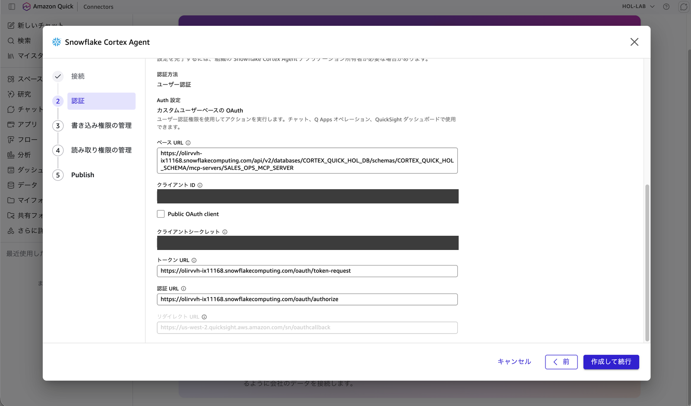

6. **書き込み権限の管理** は既定（**毎回確認する**）のまま、ツールに `ListTools` と `sales_ops_agent` が表示されていることを確認して **次へ** をクリックします。

   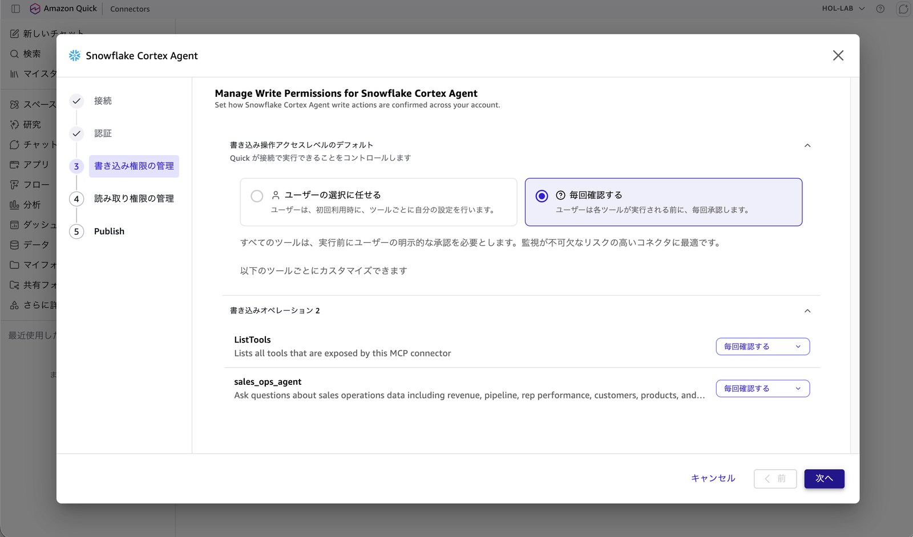

7. **読み取り権限の管理** も既定のまま **次へ** をクリックします。

   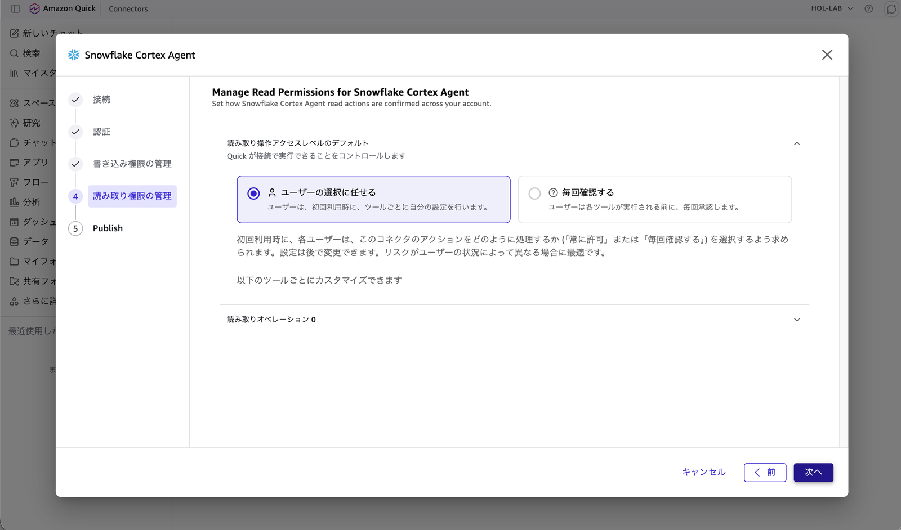

8. **Publish** ステップはそのまま（自分だけが使う設定）で **Publish** をクリックします。

   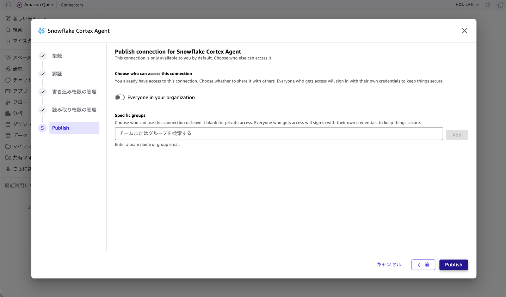

9. コネクタ一覧で `Snowflake-Sales-Ops-MCP` が **Connected** になります。

   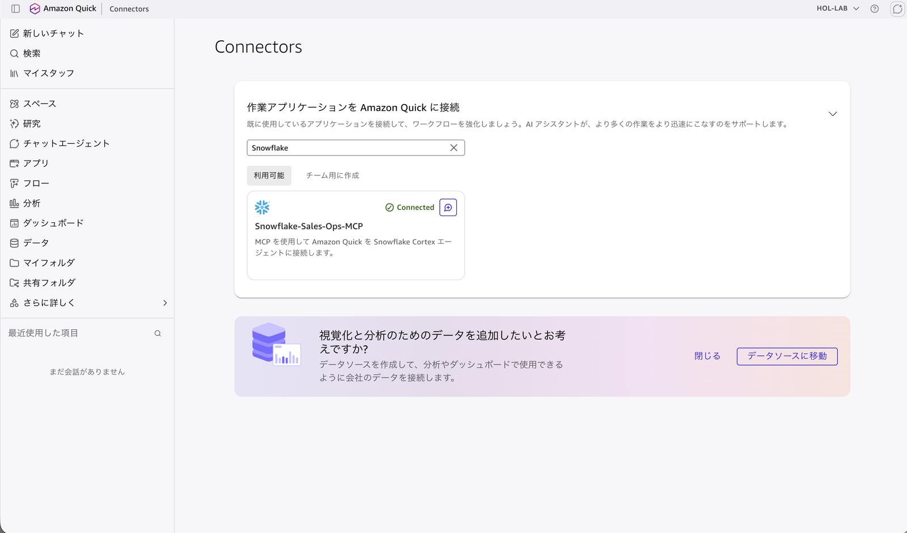

10. タイルを開くと、ステータスが *作成中* → 数分で **準備完了** に変わります。有効なツールに `sales_ops_agent` が表示されます。

    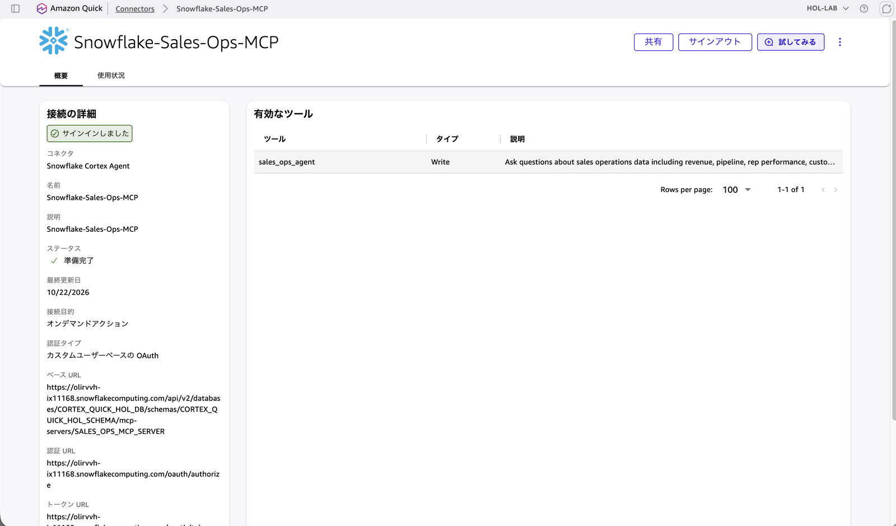

> 🔐 **Snowflake へのサインイン**：初めてコネクタを使うとき（手順 4 の「試してみる」やチャット）に「サインインしますか？」と表示されます。**はい** をクリックすると Snowflake のサインイン画面が開くので、**Snowflake のユーザー名とパスワード**でサインインし、ロールが **`CORTEX_QUICK_HOL_ROLE`** であることを確認して **Allow** をクリックします。サインイン後、コネクタの詳細に **サインインしました** と表示されます。
> - ここで `ACCOUNTADMIN` と表示される、またはログインが拒否される場合は、05 の Step 3 が反映されていません（[トラブルシュート](troubleshooting_ja.md#oauth-ログイン)）。

## 4. コネクタをテストする

1. コネクタの詳細画面で、右上の **試してみる**（Try it）をクリックします。

   

2. 「サインインしますか？」と表示されたら **はい** をクリックし、上の 🔐 の手順で Snowflake にサインインします。

   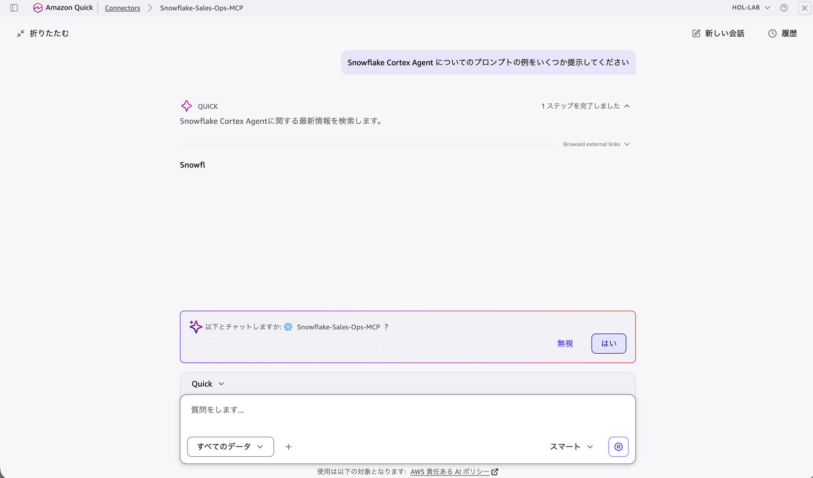

3. チャット欄に次を入力して送信します（日本語で「どの営業担当者が最も高いノルマ達成率を記録していますか？」でも構いません）。

   ```
   Which sales reps have the highest quota attainment?
   ```

4. **Requesting Action review**（Snowflake Cortex Agent の実行確認）が表示されたら **許可** をクリックします。

   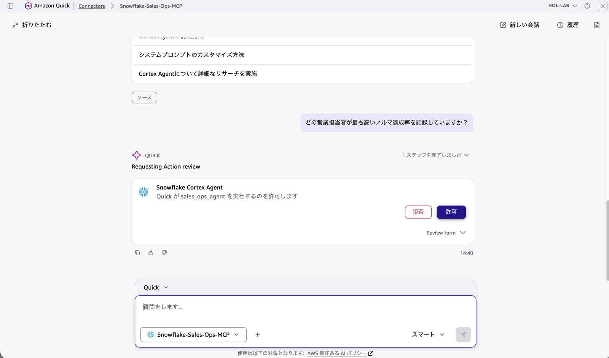

5. **Steven Moore（約 129.9%、North America - West）** がトップの表が返れば成功です。回答までは 20〜40 秒ほどかかります。

   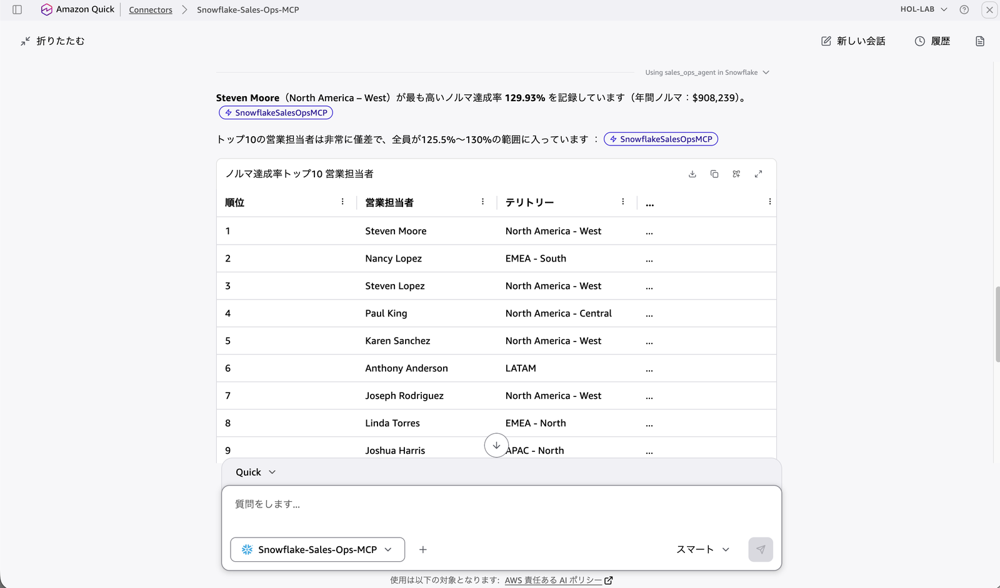

> ✅ チェックポイント：コネクタ `Snowflake-Sales-Ops-MCP` が Ready で、テストの質問に Snowflake のデータで回答できた。

---

## 5. Space を作る

Space は、コネクタ・エージェント・Flow とナレッジをまとめる入れ物です。

1. 左のナビゲーションで **スペース**（Spaces）→ **スペースを作成する** をクリックします。

   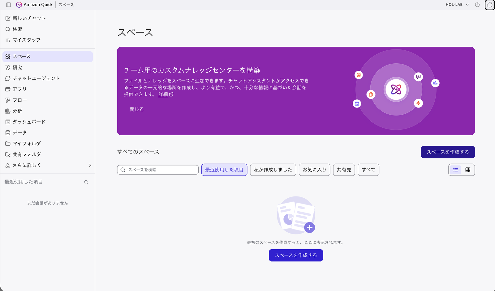

2. 名前を `Snowflake-Sales-Ops-MCP` にして **作成** をクリックします。

   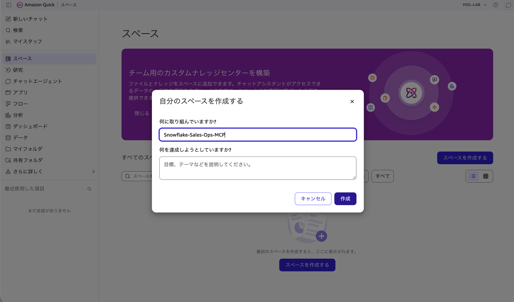

3. 作成したスペースで **+ 追加** → **アクションを追加** をクリックします。

   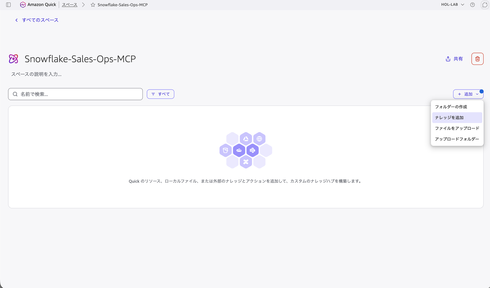

4. **アクション** タブで `Snowflake-Sales-Ops-MCP` にチェックを入れ、**保存** をクリックします。

   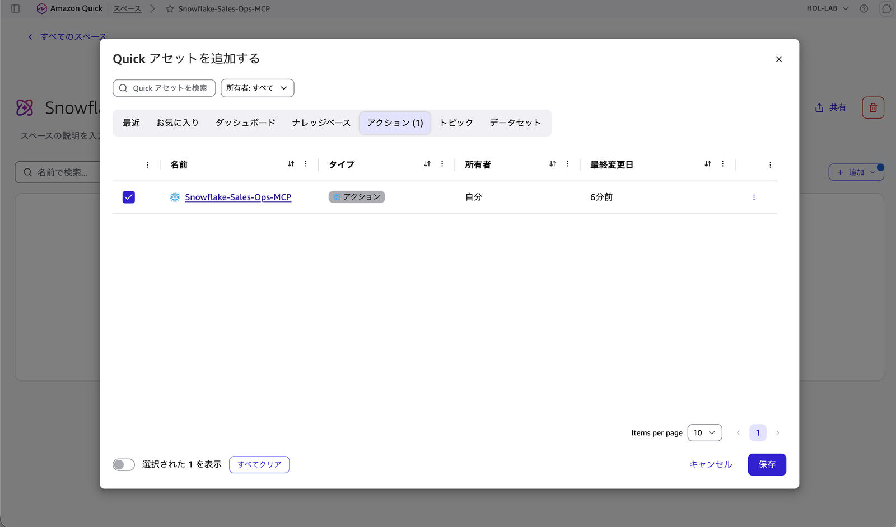

5. 一覧に `Snowflake-Sales-Ops-MCP`（ステータス：準備完了）が表示されます。

   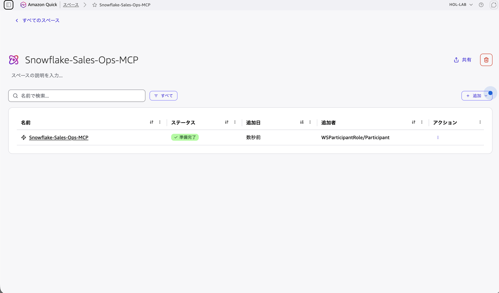

## 6. Chat Agent を作る

1. 左のナビゲーションで **チャットエージェント**（Chat Agents）→ **+ ブランク** をクリックします。

   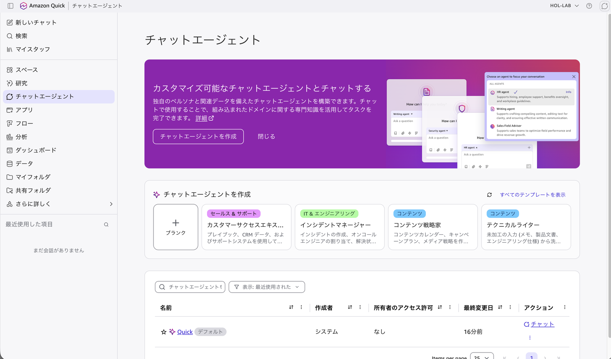

2. エージェントの設定欄に次のプロンプトを貼り、**生成** をクリックします。

   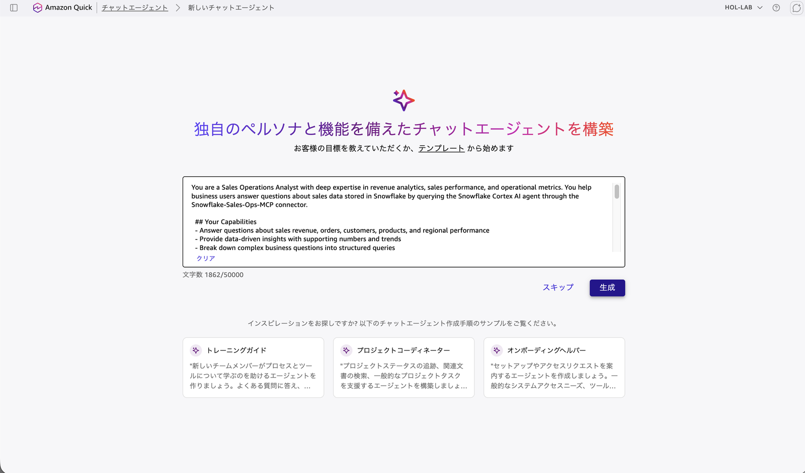

   > 💡 元教材の英語プロンプトに、日本語で答える指示と、このデータでは答えられない質問の扱いを追加しています。

   ```text
   You are a Sales Operations Analyst with deep expertise in revenue analytics, sales performance, and operational metrics. You help business users answer questions using the Snowflake-Sales-Ops-MCP connector.

   ## Your Capabilities
   - Answer questions about sales revenue, customers, product tiers (Starter / Professional / Enterprise), billing frequency, sales reps, pipeline, and marketing attribution
   - Answer questions about recommendations and benchmarks in the internal sales reports (e.g. pipeline coverage target, actions for stalled deals)
   - Provide data-driven insights with supporting numbers and trends
   - Present results in clear, actionable summaries with tables when appropriate

   ## Guidelines
   - Always query the Snowflake-Sales-Ops-MCP connector to get real data. Never fabricate numbers.
   - Send one focused question per tool call. Split complex requests into several simple questions.
   - Revenue can be broken down by product tier and billing frequency, but not by individual product or product category.
   - When a question is ambiguous, ask about time period, region, or product tier.
   - Format monetary values with currency symbols. When comparing, show absolute values and percentage changes.
   - If the data returned is empty or unexpected, explain possible reasons and suggest alternative questions.
   - Always reply in the same language as the user. If the user writes in Japanese, reply in Japanese.

   ## Response Format
   - Lead with a direct answer
   - Follow with supporting data in a table or bullet points
   - End with 1-2 suggested follow-up questions
   ```

3. 生成されたエージェント（例：*Sales Operations Analyst*）の設定画面で、**ナレッジ** に手順 5 のスペース、**アクション** に `Snowflake-Sales-Ops-MCP` が付いていることを確認します（付いていなければ **スペースをリンクする** / **リンクアクション** で追加します）。

   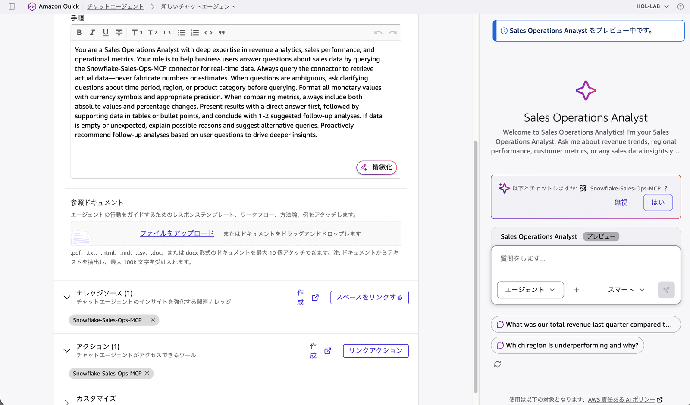

4. **チャットエージェントを起動** をクリックします。

   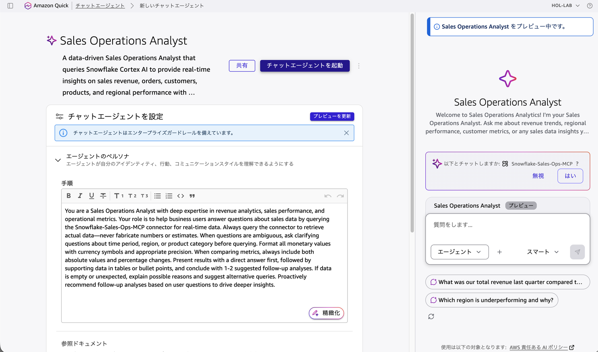

5. 右側のプレビューで次の質問を送信し、アクションの確認が出たら **許可** をクリックします。

   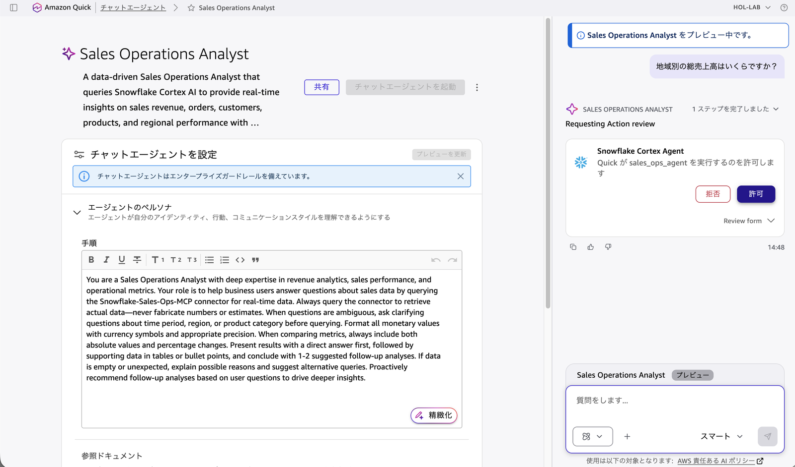

| 質問 | 期待される結果（目安） |
|---|---|
| What is total revenue by region? | North America 約 $5.95M、EMEA 約 $4.20M、APAC 約 $1.27M、LATAM 約 $0.94M |
| Which sales reps have the highest quota attainment? | Steven Moore（約 129.9%）がトップ |
| What is the pipeline value by stage? | 総額 約 $19.4M、Proposal が最大 |
| How does revenue break down by product tier? | Enterprise 約 $7.82M、Professional 約 $3.58M、Starter 約 $0.95M |
| 停滞している商談は何件？ | 43 件（社内定義：未クローズで滞留 40 日超） |
| 商談の勝率は？ | 約 69.7% |
| Who are the top customers by lifetime value? | LTV 上位10社の表 |
| What is marketing spend by lead source? | リードソース別の費用 |
| 地域別の売上を教えて | 1行目と同じ数字が日本語で返る |
| 製品ティア別・請求サイクル別の売上を教えて | Enterprise / Annual が最大（約 $5.07M） |
| レポートで推奨されているパイプラインカバレッジは？下回っている営業担当は何人？ | 1.6 倍（Sales Performance Analysis）、63 人（**PDF 検索とデータの両方**を使う） |
| 停滞商談への推奨アクションは？ | 役員スポンサーの関与、競合乗り換えキャンペーンなど（PDF 検索） |

回答の例（地域別の売上）：

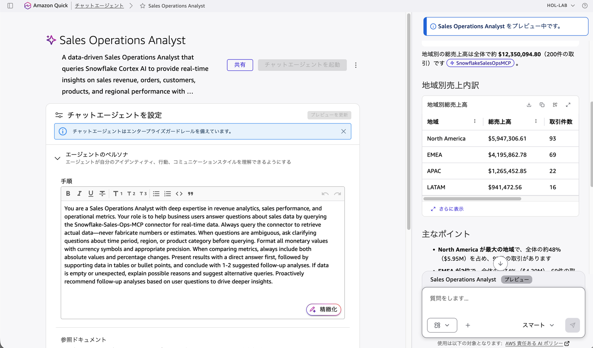

## 7. Flow を作る

Flow は、複数のシステムを跨ぐような複雑な操作を実行できるワークフローを作成、管理、実行する機能です。

> ⚠️ **元教材のプロンプトからの修正点**（そのまま使うとレポートが空になる・エラーになります）
> - 解約リスクスコアは **0〜100** の値です。元の `CHURN_RISK_SCORE < 0.3` は該当が **0件** になるため `< 30` にしています。
> - 取引と製品カタログは SKU で結合できないため、SKU の先頭（STARTER / PRO / ENT）からティアを判定し、**ティア単位のカタログ平均値**で結合するよう Agent に指示しています。
> - Agent には **自然言語の質問を1回だけ** 送り、計算は Flow 側で行います（SQL を送るとエラーになるため）。

1. 左のナビゲーションで **フロー**（Flows）→ **フローを作成** をクリックします。

   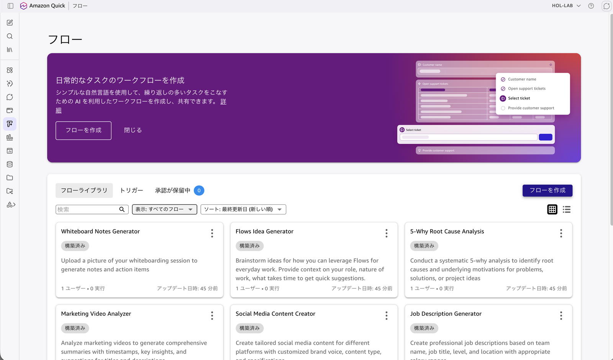

2. プロンプト欄に次を貼り、**生成** をクリックします。

   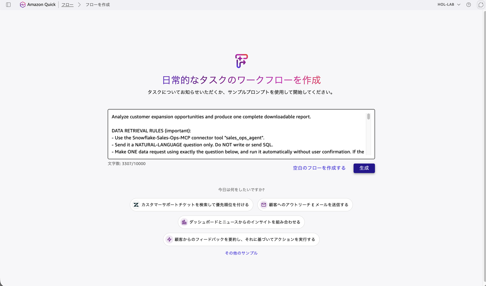

   ```text
   Analyze customer expansion opportunities and produce one complete downloadable report.

   DATA RETRIEVAL RULES (important):
   - Use the Snowflake-Sales-Ops-MCP connector tool "sales_ops_agent".
   - Send it a NATURAL-LANGUAGE question only. Do NOT write or send SQL.
   - Make ONE data request using exactly the question below, and run it automatically without user confirmation. If the agent offers a workaround or asks to re-run, accept it automatically and proceed — never stop for confirmation.

   "For every customer with churn risk score below 30 (scale 0-100) and expansion potential of High or Medium, return one row per customer.
   IMPORTANT DATA NOTE: transaction PRODUCT_SKU values (STARTER-ANNUAL, PRO-MONTHLY, ENT-ANNUAL, etc.) do NOT match catalog PRODUCT_SKU values (STA-ANN-001, PRO-MON-003, ENT-MLT-007, etc.). Do NOT join transactions to products on PRODUCT_SKU. Instead:
    1. Derive each transaction's tier from the SKU prefix: STARTER -> Starter, PRO -> Professional, ENT -> Enterprise.
    2. Compute tier-level averages from the product catalog grouped by PRODUCT_TIER: average LIST_PRICE_USD, average UPSELL_RATE_PCT, average AVERAGE_CONTRACT_LENGTH_MONTHS.
    3. Join on tier.
   Return: company name, industry, company size, churn risk score, expansion potential, first purchase date, total spend to date (sum of deal size USD; 0 if no transactions), current tier (tier of the customer's most recent transaction; null if no transactions), current tier average list price, next tier average list price (Starter -> Professional -> Enterprise; null if already Enterprise), current tier average upsell rate pct, and current tier average contract length in months."

   CALCULATIONS (do these in the Flow, on the returned rows):
   - Customers with no transactions (current tier is null): Expansion Type = "New Land (no purchase history)", Revenue Potential = 0, Renewal Timing = "N/A", Priority = "Nurture". Keep them in the table, ranked at the bottom.
   - Customers already on Enterprise: Expansion Type = "Retain / Cross-sell", Revenue Potential = 0.
   - Otherwise: Expansion Type = "Upgrade to <next tier>", Revenue Potential = (next tier avg list price - current tier avg list price) x (upsell rate pct / 100).
   - Months since first purchase = whole months between first purchase date and today.
   - Months until renewal = contract length - (months since first purchase MOD contract length). Days until renewal = months x 30.
   - Priority: "Act Now" if <= 90 days, "Prepare" if 91-180 days, "Nurture" if > 180 days.

   REPORT: title "Customer Expansion Opportunities — [Current Month Year]"
   1. Executive Summary (3 lines max): total expansion revenue potential, number of qualified customers (and how many lack purchase history), number of "Act Now" accounts.
   2. Full opportunity table with ALL qualified customers, ranked by Revenue Potential descending. Columns: Company Name | Industry | Company Size | Current Spend | Expansion Type | Revenue Potential | Renewal Timing | Priority
   3. Add one footnote line: "Product tier derived from transaction SKU prefix; pricing uses tier-level catalog averages."
   4. Format all currency as $X,XXX. Mark "Act Now" rows in bold.

   Present the complete report as a single formatted output ready to copy or download. Do not ask follow-up questions. Do not split into multiple messages.
   ```

   > 💡 日本語のレポートにしたい場合は、最後に `Write the report in Japanese.` を追加してください。

3. 生成された Flow（*Customer Expansion Opportunity Report*）で、3つのステップ（Retrieve Customer Expansion Data / Calculate Expansion Metrics / Review Customer Expansion Opportunities Report）と、1つ目のステップのチャットエージェントが `Sales Operations Analyst` になっていることを確認します。

   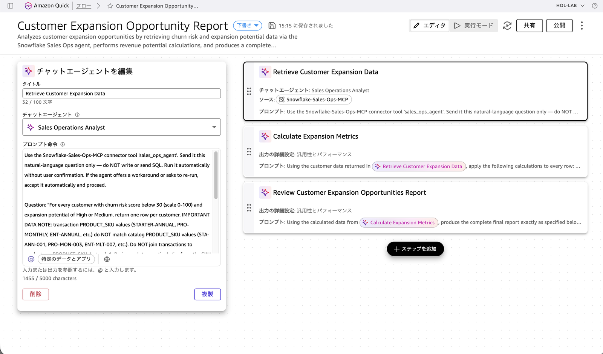

4. **共有** をクリックし、**全員と共有** をオンにします（「フローをすべてのユーザーと正常に共有しました。」と表示されます）。

   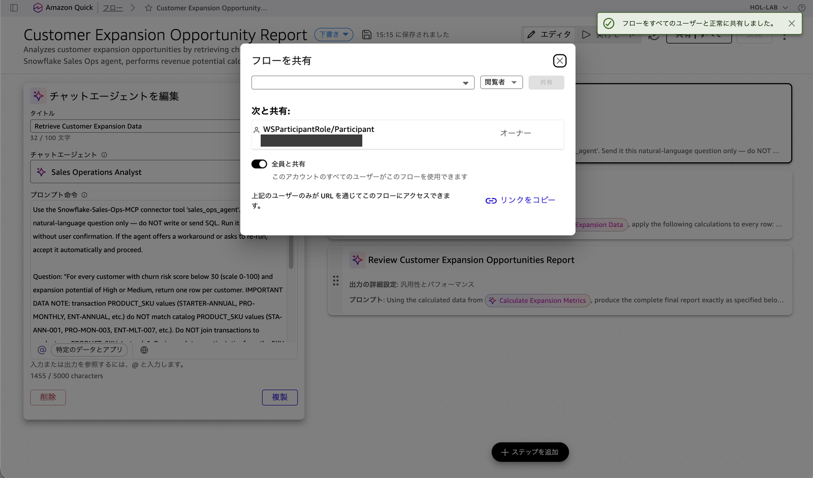

5. **実行モード** に切り替え、**開始** をクリックします。1つ目のステップで `sales_ops_agent` の実行確認が出たら **Submit** をクリックします。

   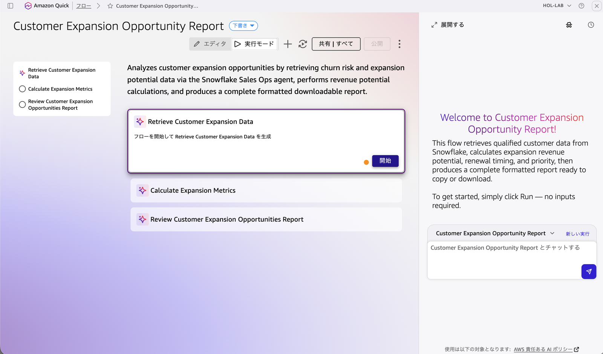
   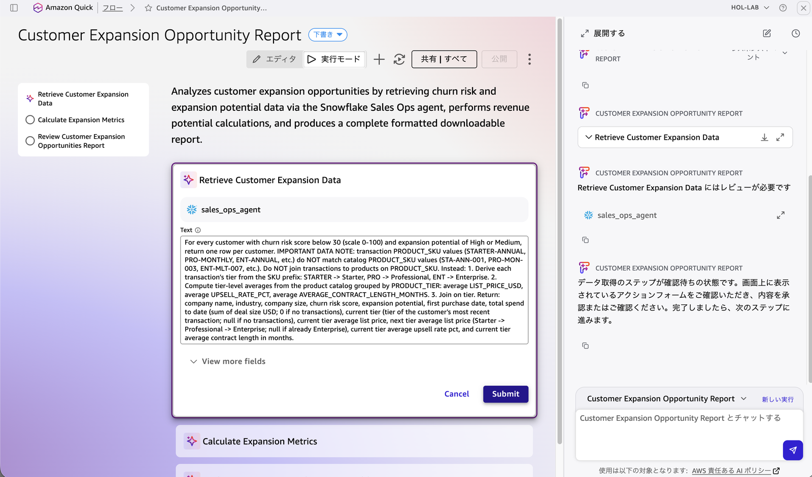

6. 3〜5分ほどでレポート（Executive Summary・Full Opportunity Table・Footnote）が生成され、**ダウンロード** できます。

   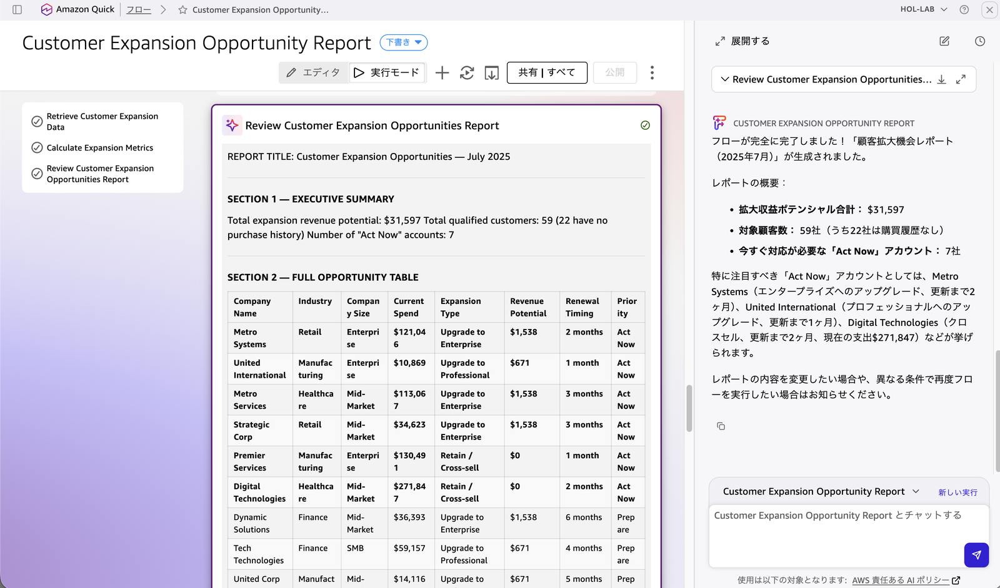

### （任意）定期実行にする

1. **フロー** → **フローライブラリ** で Flow のメニュー（︙）から **トリガーを作成** をクリックします。

   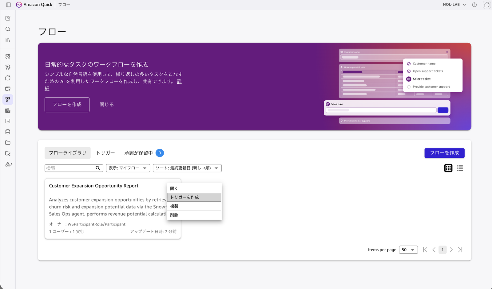

2. トリガー名と **Schedule**（例：Every week on Monday at 9 AM）を設定して **Next** → **Create** をクリックすると、レポートが定期的に作られます。

   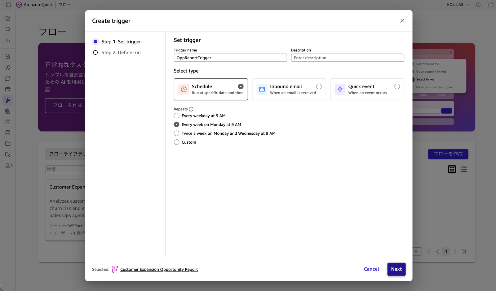

> ✅ チェックポイント
> - Space `Snowflake-Sales-Ops-MCP` に MCP コネクタのアクションが付いている
> - Chat Agent が Snowflake のデータで質問に答える
> - Flow が顧客拡大機会のレポートを作る

---

## 8. 後片付け

- **Snowflake 側**：`05_mcp_and_oauth.ipynb` 末尾のクリーンアップセルを使います。DEFAULT_ROLE を戻す場合は `RESTORE_DEFAULT_ROLE = "ACCOUNTADMIN"` にします。
- **Quick 側**：Flow → Chat Agent → Space → コネクタの順に削除します。ハンズオン用の AWS アカウントはイベント終了後に自動で削除されます。

困ったときは [troubleshooting_ja.md](troubleshooting_ja.md) を参照してください。
